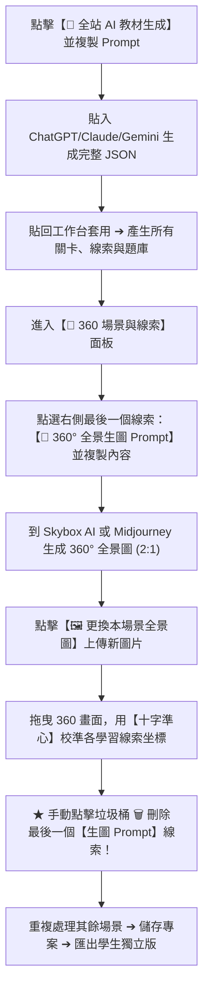

# 🌾 南投食農小旅行 ── 360° 從產地到餐桌

本資料夾是以「360° 全景沉浸式互動教材製作工具」改編的**南投食農教育版**，已內建五關完整教材：

| 關卡 | 產地與農產 | 徽章 |
| :--- | :--- | :--- |
| 1 | 鹿谷・凍頂烏龍茶 | 凍頂製茶小師傅 |
| 2 | 魚池・日月潭紅茶 | 紅茶品茗小專家 |
| 3 | 埔里・茭白筍 | 護水筍田小農夫 |
| 4 | 信義・梅子 | 醃梅加工小達人 |
| 5 | 竹山・竹筍 | 竹林尋筍小獵人 |

- 雙擊 `啟動教師線索設定工具.bat` 開啟教師工作台；`dist/` 裡已有一份可直接給學生用的獨立版 HTML。
- 目前 `img/pano/` 是程式繪製的**示意暫用圖**。請把 `CODEX_生圖任務.md` 交給 Codex 生成精美 360° 全景圖，再用工作台的十字準心微調線索位置即可。
- 每關最後一個「🎨 360° 全景生圖 Prompt」線索是給老師用的，校準完請用 🗑️ 刪除。

---

# 360° 全景沉浸式互動教材製作工具 ── 使用手冊

本資料夾（`360全景教材製作工具`）為專為教師與教材創作者打造的**完全獨立、一站式 360° VR 沉浸式互動教材創作套件**。

本套件整合了「全站 AI 大綱與題目生成」、「360° 全景生圖提示詞管道」、「十字準心熱點視覺化校正」與「單檔獨立學生離線版 HTML 匯出」功能，教師**無需撰寫任何程式碼**，即可在數十分鐘內產出一套高品質、支援跨載具（平板、觸控大螢幕、電腦）的沉浸式探索自學遊戲！

---

## 目錄

- [一、資料夾架構說明](#一資料夾架構說明)
- [二、環境需求與一鍵啟動](#二環境需求與一鍵啟動)
- [三、⭐ 核心亮點工作流程：AI 全站生成 ➔ 360 生圖 ➔ 熱點校準 ➔ 刪除生圖線索](#三-核心亮點工作流程ai-全站生成--360-生圖--熱點校準--刪除生圖線索)
- [四、關卡題庫、大魔王與通關證書設定](#四關卡題庫大魔王與通關證書設定)
- [五、儲存專案與一鍵匯出學生獨立版 HTML](#五儲存專案與一鍵匯出學生獨立版-html)
- [六、GitHub Pages 線上免安裝部屬指南](#六github-pages-線上免安裝部屬指南)
- [七、360° 全景圖規格與生圖工具推薦](#七360-全景圖規格與生圖工具推薦)
- [八、常見問題與排解技巧 (FAQ)](#八常見問題與排解技巧-faq)

---

## 一、資料夾架構說明

本資料夾已完整自帶所需的前後端檔案，可隨意複製搬移至其他目錄或電腦使用：

```text
360全景教材製作工具/
├── 啟動教師線索設定工具.bat    # ★ 一鍵啟動入口（自動檢測 Python、安裝套件並啟動網頁）
├── teacher_editor.py        # 本機微型伺服器與學生單檔 HTML 打包引擎
├── editor.html              # 教師視覺化編輯工作台（Web GUI 介面）
├── sync_pano.py             # 全景圖與證書離線 Base64 素材自動同步模組
├── index.html               # 學生端遊戲前端樣板（打包獨立版時的骨架）
├── README.md                # 本說明手冊
│
├── data/                    # 教材專案設定資料庫
│   ├── eras.json            # 完整教材資料（場景、線索熱點、題庫、外觀文案）
│   ├── eras.js              # 同步供本地端直接引用的 JavaScript 資料
│   ├── pano_data.js         # 自動轉為 Base64 的 360° 全景影像資料庫
│   └── cert_data.js         # 探險家證書與隊長吉祥物離線資源庫
│
├── dist/                    # ★ 匯出的「學生獨立版 HTML」儲存目錄
│   └── [教材名稱]_學生獨立版.html
│
├── img/                     # 圖片素材庫
│   ├── pano/                # 各場景 360° 全景圖（.jpg / .png）
│   ├── badges/              # 關卡過關徽章圖示
│   ├── mascot.png           # 引導小隊長吉祥物圖示
│   └── certificate-bg.png   # 探險家結業證書底圖
│
├── js/                      # 前端互動邏輯模組
│   ├── editor_studio.js     # 教師工作台核心操作腳本
│   ├── pannellum.js         # 360° 全景檢視引擎
│   ├── viewer.js            # 學生端全景渲染與熱點探尋
│   ├── quiz.js              # 生存測驗答題與計分模組
│   ├── certificate.js       # HTML5 Canvas 證書即時繪製引擎
│   ├── storage.js           # 本地遊戲進度儲存
│   ├── audio.js             # 音效控制
│   ├── markdown.js          # Markdown 表格解析器
│   └── app.js               # 學生端主控制器
│
└── css/                     # 樣式表
    ├── pannellum.css        # 全景播放器樣式
    └── style.css            # 遊戲主要風格與版面
```

---

## 二、環境需求與一鍵啟動

### 1. 系統環境
- **作業系統**：Windows 10 / 11
- **瀏覽器**：Google Chrome、Microsoft Edge 等現代瀏覽器

### 2. 啟動方式
直接雙擊滑鼠左鍵執行 **`啟動教師線索設定工具.bat`**。

> [!NOTE]
> 批次檔內建智慧引導：
> - 自動偵測官方 Python（排除微軟商店沙盒版），若未安裝會自動呼叫 `winget` 或下載官方靜默安裝。
> - 自動檢查並安裝影像處理套件 `Pillow`。
> - 自動在本機（`http://127.0.0.1:8088`）啟動服務並為您開啟 `editor.html` 工作台。
> - 如欲關閉伺服器，直接關閉該黑底視窗或按下 `Ctrl + C` 即可。

---

## 三、⭐ 核心亮點工作流程：AI 全站生成 ➔ 360 生圖 ➔ 熱點校準 ➔ 刪除生圖線索

本系統最強大的地方，在於**將「大語言模型 (LLM) 出題」與「360° AI 生圖」無縫串接**。以下是完整製作教學：



---

### 詳細操作步驟說明

#### 步驟 1：取得 AI 全站生成 Prompt
1. 開啟工作台後，點擊頂部功能列顯眼的紫色按鈕：**`🤖 全站 AI 教材生成`**。
2. 在彈出的視窗中，點擊「**📋 複製全站 AI 生成 Prompt**」。
3. 此提示詞已經內嵌了標準的架構規則、國小難度規範、Markdown 比較表格式，以及最關鍵的**「360° 防魚眼失真全景生圖指示」**。

---

#### 步驟 2：讓 AI 生成教材並匯入套用
1. 打開你常用的 AI 工具（**ChatGPT、Claude、Google Gemini** 皆可）。
2. 將複製的提示詞貼上，並修改主題中括號內的文字，例如：
   > *「請為主題【人體奧秘大冒險：消化系統巡航】，設計一套適用於國小五年級學生的 360° 沉浸式互動學習教材完整內容。」*
3. AI 將輸出合法的 JSON 代碼區塊（以 ````json ... ```` 包裹）。
4. 整段複製 AI 產生的 JSON，回到工作台的「**第二步：貼上 AI 回傳的 JSON 代碼區塊**」輸入框中。
5. 點擊「**套用 JSON 至全站**」。
6. 🎉 **瞬間完成**：全站主題文案、所有關卡、學習探索線索、闖關題庫、總表與證書表揚詞全部自動就緒！

---

#### 步驟 3：提取該關卡最後一個「生圖 Prompt」線索
切換至 **`🧭 360 場景與線索`** 面板：
1. 在上方場景標籤列切換到第一個關卡（例如：「口腔與食道」）。
2. 查看右側的「生活線索設定」卡片列表，拉到**最底下的最後一個線索**。
3. 你會看到一個帶有調色盤圖示的特殊線索：
   - **標題**：`🎨 【360° 全景生圖 Prompt】（點此複製）`
   - **內文**：AI 已經根據該場景的教學重點，為你量身寫好一段超詳細的**英文 360° Equirectangular 專業生圖提示詞**（包含平視地平線、人眼尺度、防魚眼畸變排除詞）。
4. 點選該卡片，反白選取並**複製裡面的英文生圖提示詞**。

---

#### 步驟 4：前往 AI 生圖工具生成 360° 全景圖
1. 最推薦工具：[**Blockade Labs Skybox AI**](https://skybox.blockadelabs.com/)（專門為 360° VR 設計，生成出來即是完美的 2:1 等距長方球體投影）。
2. 將剛剛複製的提示詞貼入 Skybox AI，選擇合適的風格（如 Digital Painting、Realistic 或 Fantasy），點擊 **Generate**。
3. 生成完成後，預覽確認環景效果無誤，點擊下載按鈕，取得 **JPG 或 PNG** 圖片檔（長寬比為 2:1）。

> [!TIP]
> 若使用 **Midjourney v6** 或 **Flux / Stable Diffusion**，請務必保留 Prompt 結尾的 `--ar 2:1 --tile`，並確保不帶魚眼鏡頭效果。

---

#### 步驟 5：上傳 360° 全景圖回關卡
1. 回到教師編輯器的該關卡畫面。
2. 點擊全景畫面右上方的 **`🖼️ 更換本場景全景圖`** 按鈕。
3. 選擇剛剛在 Skybox AI 下載好的全景圖上傳。
4. 伺服器會自動儲存至 `img/pano/`，360 畫面會立刻更新為你剛生成的專屬情境！

---

#### 步驟 6：旋轉視野，使用「十字準心」校準學習線索
1. 現在全景畫面中已經有了生動的環境與物體（例如：牙齒、唾液腺、食道入口等）。
2. 在右側線索列表中，點選要定位的學習線索（例如：線索 1「唾液的作用」）。
3. 用滑鼠在 360 畫面中按住拖曳視角，將畫面正中央的**紅色「十字準心」**對準畫面中的唾液腺。
4. 點擊工具列上的 **`📍 將選取線索移至準心`**（快捷功能）。
5. 該線索立即被精準定位在此角度（Yaw 水平角 / Pitch 俯仰角）！
6. 依序點選線索 2、線索 3、線索 4...，重複將它們瞄準並校正到畫面中對應的物體上。

---

#### 步驟 7：⭐ 核心關鍵操作 ── 手動刪除最後一個「生圖 Prompt」線索！
校準完實際的學習線索後，請務必執行此清理動作：

> [!IMPORTANT]
> **為什麼必須手動刪除這個線索？**
> `🎨 【360° 全景生圖 Prompt】` 只是 AI 在製作階段提供給老師生圖用的「腳手架/輔助工具」。
> 如果不刪除它，學生在遊玩時會看到這個充滿英文生圖指令的線索，甚至會影響「找齊所有生活線索才解鎖生存挑戰」的計算！

1. 在右側線索列表中，捲動到最底端，找到 `🎨 【360° 全景生圖 Prompt】` 卡片。
2. 點擊該卡片右上角的 **垃圾桶圖示 🗑️**（刪除按鈕）。
3. 瀏覽器跳出確認對話框時，點擊「確定」。
4. 該生圖提示詞線索隨即被乾淨移除，該場景只留下真實要讓學生探索的學習熱點！

---

#### 步驟 8：重複處理其他關卡場景
點擊上方的場景標籤切換到下一關（關卡 2「胃部消化工廠」、關卡 3「小腸吸收之旅」...），依照相同流程操作：
- **複製最後一個線索的生圖 Prompt ➔ Skybox AI 生圖 ➔ 上傳全景圖 ➔ 十字準心校正學習線索 ➔ 刪除生圖線索**。

---

## 四、關卡題庫、大魔王與通關證書設定

全部場景的影像與線索就定位後，可依序切換上方標籤進行內容審核：

### 1. 📝 關卡題庫挑戰 (Quiz View)
- 檢查各關卡問答題目、四個選項與正確答案。
- 點選選項左側的單選圓鈕即可指定正確答案。
- 可調整提示（Hint）與答對時的詳細解析（Explain）。

### 2. 📊 比較總表與大魔王 (Comparison & Final Boss)
- **終極大魔王**：學生全破所有關卡後迎來的綜合挑戰大考驗。
- **比較總表 Markdown 編輯器**：左側為 Markdown 原始碼，右側為學生端即時預覽，可用於各關卡特性的橫向比較與歸納。

### 3. ⚙️ 教材整體文案與外觀 (Settings View)
- 設定教材大標題（App Title）、副標題、冊別標籤。
- 自訂首頁導讀文字與啟動按鈕。
- **探險家證書設定**：自訂頒發單位（Issuer）、榮譽稱號，以及過關時印製在結業證書上的四行表揚詩詞。

---

## 五、儲存專案與一鍵匯出學生獨立版 HTML

### 1. 儲存專案
隨時點擊右上角的 **`💾 儲存並回存專案`** 按鈕，系統會將最新設定自動儲存至 `data/eras.json` 與 `data/eras.js`。

### 2. 匯出學生獨立版（單一 HTML）
當全部內容校對完成後，點擊頂部綠色的 **`📦 匯出學生獨立版`** 按鈕：
1. 打包引擎會自動將：
   - 所有的 360° 全景圖（JPG）壓縮轉換為內嵌 Base64
   - 吉祥物小隊長圖示（`mascot.png`）與關卡過關徽章轉換為內嵌 Base64
   - 證書底圖（`certificate-bg.png`）轉為免 CORS 離線資源
   - Pannellum 360 核心、所有 CSS 樣式、題庫邏輯與通關證書產生器完整內聯（Inline）
2. 匯出完成後：
   - 瀏覽器會自動下載該檔案（例如：`人體奧秘大冒險_學生獨立版.html`）。
   - 本資料夾內的 **`dist/`** 目錄中也會自動另存一份相同的檔案。
3. **分發給學生**：
   - 此 HTML 為**單一檔案、零外部依賴、免伺服器**。
   - 學生只需用 Chrome / Edge 直接雙擊開啟，即使拔除網路線也能 100% 順暢遊玩！
   - 通關後可輸入學生姓名，一鍵下載個人專屬探險家結業證書（PNG 圖片）。

---

## 六、GitHub Pages 線上免安裝部屬指南

本工具已全面升級為**「雙引擎架構」**，**不一定要在本機執行 Python！** 

您可以直接將靜態網頁檔案上傳至 GitHub，並啟用免費的 **GitHub Pages** 服務，將本工具轉化為隨開即用的雲端線上創作平台：

### 1. 線上打包運作原理
- 當系統偵測不到本機 Python 後端時，工作台會無縫切換為**純前端內聯打包引擎**。
- 透過瀏覽器的非同步傳輸 (`fetch`) 與二進位打包 (`Blob`)，在瀏覽器記憶體中直接將所有 360° 全景圖 Base64、JS 模組、CSS 樣式與題庫壓合成單一檔案。
- 因此在 GitHub Pages 上點擊 **「📦 匯出學生獨立版」**，同樣能**一秒下載獨立免伺服器的單檔 HTML**！

### 2. GitHub Pages 部屬 3 步驟
1. **建立儲存庫**：在 GitHub 建立一個公開或私人 Repository（例如 `my-360-vr-maker`）。
2. **上傳檔案**：將本資料夾內的所有內容（`editor.html`、`index.html`、`css/`、`js/`、`data/`、`img/` 等）上傳或推送至 GitHub。
3. **開啟 GitHub Pages**：
   - 進入儲存庫的 **Settings ➔ Pages**。
   - 在 **Branch** 選取 `main`（或 `master`），資料夾選取 `/ (root)`，點擊 **Save**。
   - 等待 1~2 分鐘，即可取得專屬公開網址：  
     `https://<你的GitHub帳號>.github.io/<儲存庫名稱>/editor.html`

### 3. 線上模式 vs 本機 Python 模式的微小差異
| 功能項目 | 本機 Python 伺服器模式 | GitHub Pages 線上靜態模式 |
| :--- | :--- | :--- |
| **360 全景圖上傳與預覽** | 支援（自動壓縮存入 `img/pano/`） | 支援（瀏覽器 FileReader 本地轉碼至記憶體） |
| **AI 提示詞生成與 JSON 匯入** | 完整支援 | 完整支援 |
| **十字準心線索坐標校準** | 完整支援 | 完整支援 |
| **一鍵匯出學生獨立單檔 HTML** | 支援（自動下載並儲存至 `dist/`） | 支援（直接由瀏覽器一鍵下載單檔 HTML） |
| **專案儲存機制** | 點「💾 儲存」直接寫回本機硬碟檔案 | 點「💾 儲存」自動下載最新 JSON 備份檔（下次點「📂 匯入」即可還原） |
| **跨載具支援** | 僅限有安裝 Python 的電腦 | **全平台免安裝**（支援 iPad、Mac、Chromebook 等） |

---

## 七、360° 全景圖規格與生圖工具推薦

為了讓 360° 全景視圖平整展開、環顧時不變形，圖片必須符合以下標準：

| 規格項目 | 標準要求 | 說明 |
| :--- | :--- | :--- |
| **投影格式** | **Equirectangular（等距長方投影）** | 標準 360° 球體展開圖（水平 360°、垂直 180°） |
| **寬高比例** | **嚴格 2：1** | 例如 `4096 × 2048` 或 `2048 × 1024` |
| **檔案格式** | JPG（最佳）、PNG、WebP | 建議單張控制在 1MB~2MB，匯出單檔載入更迅速 |
| **視角水平線** | 平視置中（Pitch 0°） | 避免仰角或俯角拍攝，否則環顧四周會產生天地歪斜 |

### 最推薦生圖平台：
- **Blockade Labs Skybox AI**（網址：https://skybox.blockadelabs.com/ ）
  - 免費或付費方案皆可，專為 360 VR 打造，匯出即為標準等距長方圖，相容性 100%！

---

## 七、常見問題與排解技巧 (FAQ)

### Q1：點擊「更換本場景全景圖」後，畫面為什麼呈現黑畫面或破圖？
- 請確認圖片是否為標準的 **2：1 長寬比**（例如 4096×2048），一般手機拍的 16:9 或 4:3 照片無法作為 360° 全景圖。

### Q2：為什麼一定要刪除最後一個「生圖 Prompt」線索？
- 該線索是 AI 在產生 JSON 時給老師看的「生圖備忘與 Prompt」。若沒刪除，學生在尋找生活線索時會看到英文提示詞，且關卡的線索總數會多算一個，影響闖關體驗。

### Q3：不小心把學習線索刪掉了怎麼辦？
- 可點擊右側上方的「➕ 新增線索」或畫面上的「➕ 在此準心新增線索」隨時補回。

### Q4：學生獨立版 HTML 在學生電腦打開很慢？
- 如果教材有 5~6 個場景，單檔 HTML 大小約在 10MB~15MB 左右（因為內嵌了所有 360 高畫質圖與音效）。
- 開啟時瀏覽器載入需 2~3 秒屬正常現象，一旦載入完成後全程完全離線快取，答題與旋轉畫面均極為流暢。

### Q5：如何備份或分享我做好的教材？
- 點擊頂部的「**📥 匯出**」可下載一份 `eras.json` 備份檔。
- 在其他電腦上的製作工具點擊「**📂 匯入**」，即可一秒載入你的所有場景與設定！
